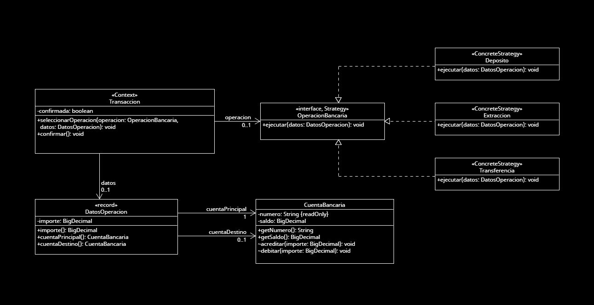
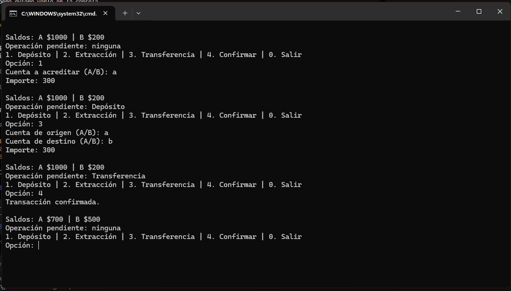

# Punto 1 — Sistema de gestión de transacciones bancarias

## Patrón: Strategy (Estrategia)

La consigna permite seleccionar un depósito, una extracción o una transferencia y cambiar de opción antes de confirmar. Cada operación tiene su propia secuencia. `Transaccion` conserva la estrategia seleccionada y los datos, pero no mueve dinero hasta llamar a `confirmar()`. En ese momento delega en `OperacionBancaria.ejecutar(datos)` sin preguntar qué clase concreta recibió.

| Rol | Elemento | Responsabilidad |
| --- | --- | --- |
| Contexto | `Transaccion` | Selecciona o reemplaza la operación pendiente, la ejecuta al confirmar y evita confirmar dos veces la misma transacción. |
| Estrategia | `OperacionBancaria` | Define la operación común `ejecutar(datos)`. |
| Estrategias concretas | `Deposito`, `Extraccion`, `Transferencia` | Definen qué cuentas intervienen y qué movimientos se hacen en cada operación. |
| Datos | `DatosOperacion` | Contiene el importe, la cuenta principal y, para transferencias, la cuenta de destino. La cuenta principal se acredita en un depósito y se debita en una extracción o transferencia. |
| Dominio | `CuentaBancaria` | Administra el saldo con `BigDecimal`. Para acreditar exige un importe positivo; para debitar verifica saldo suficiente y que el importe sea positivo. |

En una transferencia se comprueba que el destino exista y sea distinto al origen antes de intentar el débito. Si no hay saldo suficiente o el importe es inválido, el débito se rechaza y no se acredita nada en destino. Si la confirmación falla, la operación sigue pendiente y se puede corregir. El ejemplo usa cuentas en memoria y no implementa persistencia ni concurrencia.

Agregar una operación implica implementar `OperacionBancaria` y ofrecerla en el menú; la lógica de confirmación de `Transaccion` no cambia.

## Diagrama UML de clases



Las flechas discontinuas con triángulo hueco son realizaciones: las tres estrategias concretas implementan `OperacionBancaria`. Las asociaciones muestran la estrategia y los datos seleccionados, y los roles de las cuentas. El diagrama no incluye la interfaz de consola ni las pruebas.

## Ejecutar y probar

Desde la raíz del repositorio, en **PowerShell**, con **Java 17**:

```powershell
cd punto-1-sistema-de-gestion
$archivos = @(Get-ChildItem -Path src, pruebas -Recurse -Filter '*.java' | Select-Object -ExpandProperty FullName)
javac --release 17 -encoding UTF-8 -d out @archivos
java -cp out transacciones.Main
```

### Demostración en consola

Las cuentas de ejemplo arrancan con **A: $1000** y **B: $200**. Elegí **1** para preparar un depósito de **$300** en A. Sin confirmarlo, elegí **3** para preparar una transferencia de **$300** de A a B. Los saldos siguen iguales hasta que elegís **4** para confirmar. La captura muestra el resultado: **A: $700**, **B: $500**.



### Pruebas automatizadas

Después de compilar, ejecutá:

```powershell
java -cp out transacciones.PruebasTransacciones
```
